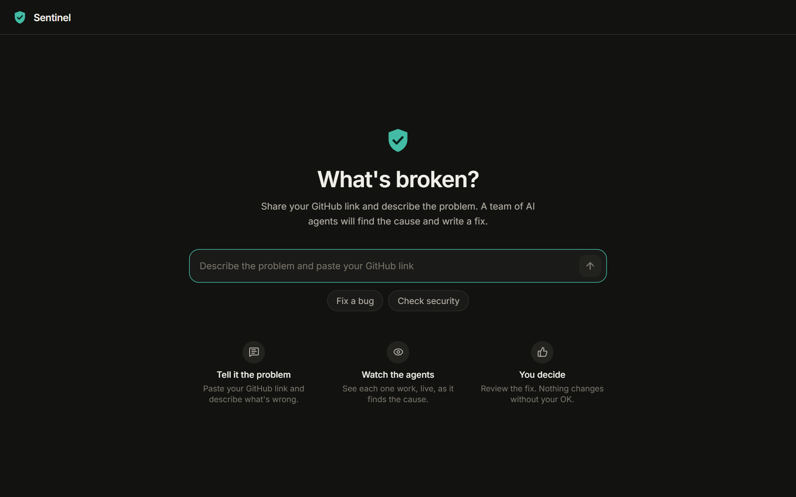
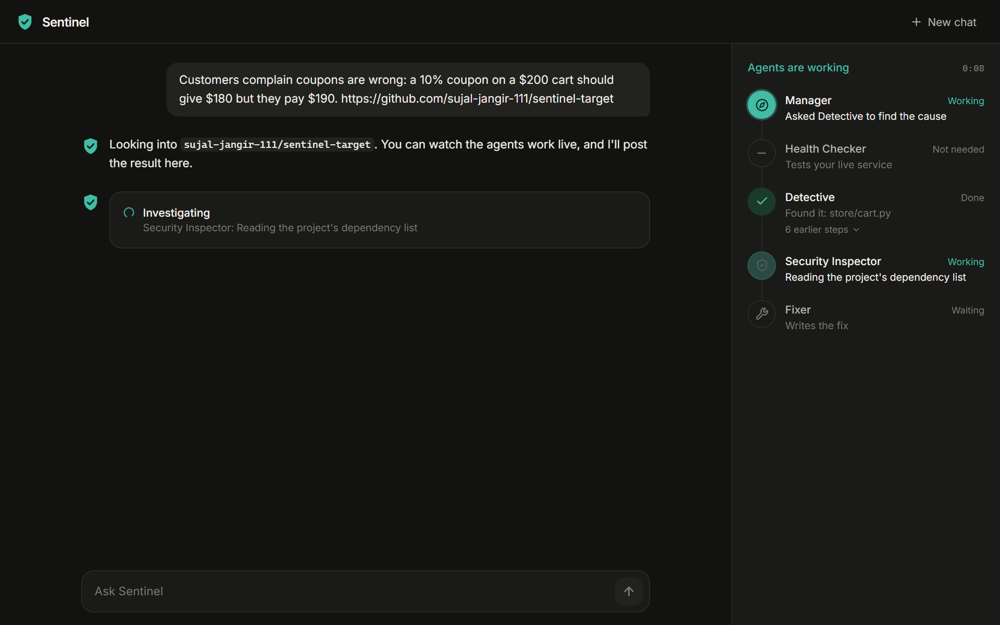
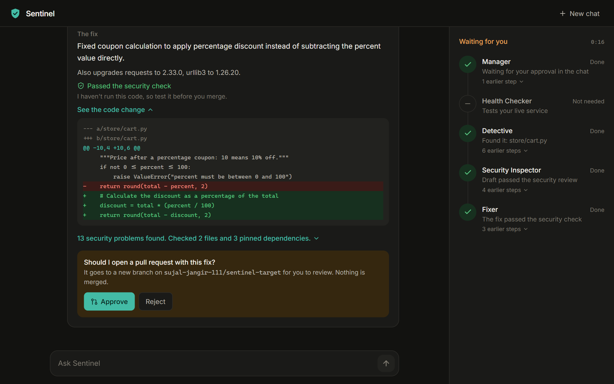
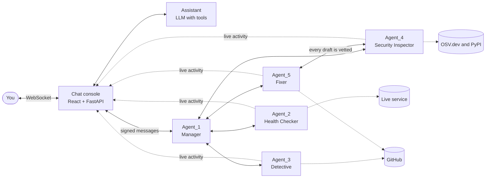
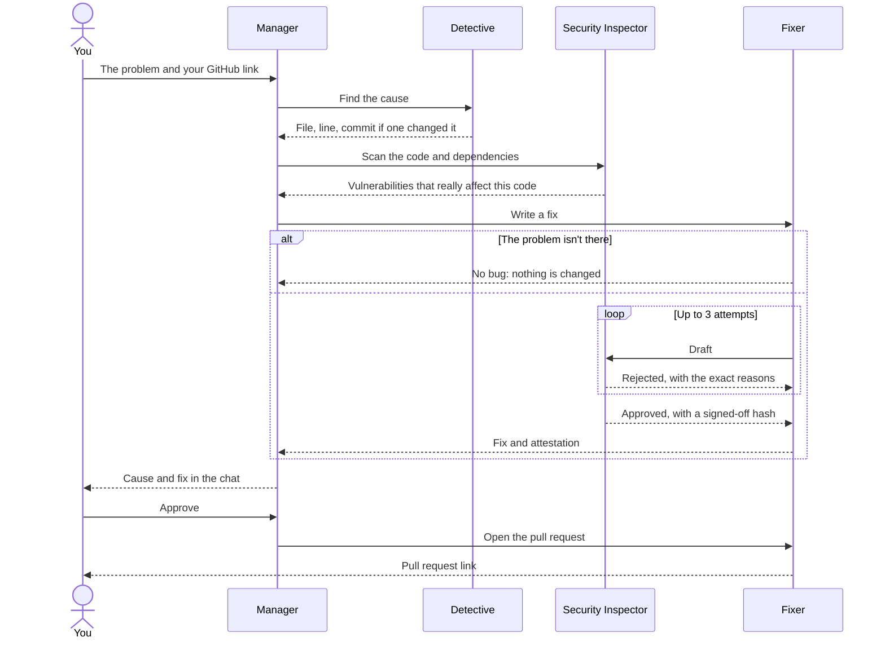

<div align="center">

# 🛡️ Sentinel

### Describe a bug and paste a GitHub link.<br>Five AI agents find the cause, write a fix, and try to reject it before you ever see it.

<br>


<br>



</div>

<br>

**Sentinel is a self-healing DevSecOps system.** There's nothing to learn and nothing to install on your repository. You open a chat, say what's wrong, and watch five agents work on it live. The cause and the fix come back in the conversation, and nothing changes on GitHub until you click Approve.

The agents, GitHub, the vulnerability database and the LLM are all real. Here's [a pull request Sentinel opened](https://github.com/sujal-jangir-111/sentinel-target/pull/5), with its root cause, findings, security attestation and SBOM.

<br>

## Contents

[What it's like to use](#what-its-like-to-use) · [How it works](#how-it-works) · [Tested against a hidden answer key](#tested-against-a-hidden-answer-key) · [Engineering decisions](#engineering-decisions) · [Tech stack](#tech-stack) · [Run it](#run-it) · [Deploy it](#deploy-it) · [Configuration](#configuration) · [Project structure](#project-structure) · [Scope and limits](#scope-and-limits) · [What's next](#whats-next) · [Background](#background)

<br>

## What it's like to use

**1. Tell it the problem.** Write it the way you'd tell a teammate, and paste your link. A traceback or a live URL helps, but neither is required.

> *A 10% coupon on a $200 cart should give $180 but customers pay $190. https://github.com/you/your-repo*

**2. Watch the agents.** The panel shows what each agent is really doing at that moment. Every line is an event the agent sent, not a progress bar someone guessed at.

<div align="center">

</div>

**3. Decide.** The cause, the exact code change and every package upgrade appear in the chat, about 15 to 60 seconds later on a small repository.

<div align="center">

</div>

- **On a repository Sentinel may write to,** Approve opens a pull request on a new branch. Nothing is ever merged for you.
- **On any other public repository,** you download the fixed files. GitHub only lets a repository's owner grant write access, so Sentinel doesn't pretend otherwise.
- **If the code is actually fine,** it says so and changes nothing.

It can also run a **security check** on any public repository in about 10 seconds. Type *"Run a security check on (your link)"*.

<br>

## How it works



Each agent is a separate process with its own cryptographic identity, built on [uAgents](https://github.com/fetchai/uAgents). They coordinate only through typed, signed messages, and every reply is checked against the address of the agent that should have sent it.

| Agent | Role | What it does |
|---|---|---|
| **Agent_1** | Manager | Runs each case as a state machine and enforces the approval gate |
| **Agent_2** | Health Checker | If you gave a URL, probes it and records errors and latency, and re-checks after a fix |
| **Agent_3** | Detective | Goes to the failing line and the commit that changed it. With only a description, it reads the relevant code to find the file |
| **Agent_4** | Security Inspector | Finds vulnerabilities and insecure code, then acts as an adversarial gatekeeper on every patch |
| **Agent_5** | Fixer | Decides whether the problem is real, drafts the fix, reworks it on rejection, and opens the pull request |

### One case, step by step



To be approved, a patch has to survive all of this. Agent_4 trusts nothing Agent_5 sends and recomputes the diff itself:

- The file must parse, and the diff must match what's really on GitHub.
- It may not add a security finding.
- It may not use a name that doesn't exist, or a standard-library attribute that isn't real.
- Every reachable vulnerability with a published fix must be gone.
- The pinned packages must be able to install together.
- If a commit changed the failing line, that change must be gone.

<br>

## Tested against a hidden answer key

Unit tests prove the code does what I expected. They can't tell you whether an AI fixed a bug correctly, so I built a harder test.

I planted **ten bugs** in [a real repository](https://github.com/sujal-jangir-111/sentinel-target), pushed them as normal-looking commits, and wrote behaviour tests the agents never see. A browser then used Sentinel as a new user, and every proposed fix was applied to a clean copy and **actually run**.

The first run looked fine in the UI, with a green "safety check" badge on every fix, and only 6 of the 10 bugs were really fixed. Some fixes made things worse. That result drove most of the design below.

| Test | First run | Now |
|---|---|---|
| **Planted bugs fixed** | 6 of 10, one only partly | **9 of 10** |
| Crash, with a pasted traceback | ✅ | ✅ |
| SQL injection | ✅ | ✅ |
| Bug spanning two files | ✅ | ✅ |
| Shared state between customers | ✅ | ✅ |
| Wrong coupon maths | ❌ Wrong file | ✅ |
| Pagination off by one | ❌ Made it worse | ✅ |
| Path traversal | ⚠️ Fixed in the wrong layer | ✅ |
| Two bugs in one file | ⚠️ One fixed | ✅ Both |
| Unsafe `eval` | ❌ App wouldn't start | ❌ Safe, but rejected valid rules |
| **False report on correct code** | ❌ Broke working code | ✅ Changed nothing |
| **Live URL, old bug** | ⚠️ Deleted working routes | ✅ Fixed, routes kept |
| **Vulnerable package** | ❌ Couldn't be installed | ✅ Only the pins changed |

**One honest caveat:** results vary between runs. The `eval` fix passed in one Groq run and failed in the next, because the model wrote code that blocked the attack but also blocked `price * 0.9`. Sentinel doesn't run a stranger's code, so a mistake like that can't be seen from the text. That's why the card says **"Passed the security check"** and **"I haven't run this code"**, and never claims the fix works.

<br>

## Engineering decisions

**The LLM never holds authority.** The model chats and drafts patches, but it can't approve anything, because approval isn't one of its tools. It can't choose a target either. During testing it invented a URL nobody had typed, so a repository or URL now only counts if the user actually wrote it.

**A fix must survive a second agent.** Approval produces a SHA-256 attestation over the exact content. Agent_5 re-derives that hash before any GitHub write, so a patch changed after approval is refused.

**"Nothing to fix" is a valid answer.** The first design rejected any patch that changed nothing and asked for another attempt. That pressured the model into "fixing" correct code, and it broke free shipping for orders of exactly $50. Now the Fixer can say there's no bug, and the case ends honestly.

**A commit is only blamed for lines it changed.** Scoring commits by file made Sentinel blame an innocent commit for an old bug. A gatekeeper rule then demanded that commit's lines be removed, and the fix deleted working routes. With no commit on the failing line, no commit is blamed.

**The chat model doesn't get to summarise your error.** It dropped the file and line from pasted tracebacks, so your own words now travel to the agents alongside its summary.

**Deterministic first.** The failing line, commit blame, reachability and the gatekeeper are plain, unit-tested Python. The LLM is used only where judgement is needed, and each use has a fallback: if the model is down, the Detective uses the report's keywords, and the agents can still start from a message containing a GitHub link.

**"No worse", not "perfect".** A patch may not add a security finding, but findings the file already had don't block it. Otherwise one old warning in a real project would reject every fix. What remains is reported to you.

**Vulnerabilities are checked against real usage.** In the demo repository, 30 known vulnerabilities reduce to the 4 the code can actually reach. Where imports can't be traced, Sentinel says so and never implies "safe".

**Upgrades have to install.** OSV says which version fixes a vulnerability, not what that version needs. A real run paired `requests` 2.33.0 with `urllib3` 1.24.1, which pip refuses, so Sentinel now reads each release's requirements from PyPI and moves companion packages too.

**Safe by default.** Sentinel writes only to allowlisted repositories, never pushes to the default branch and never merges. Secrets are masked before anything reaches the LLM, a log or the UI. Repository content is treated as data, never as instructions.

**Safe to expose.** On a public host the console requires a password, refuses to start without one, and rejects cross-site requests. User-supplied URLs are resolved first, so they can't reach the host's own ports, a private network or a cloud metadata service. Each browser is its own session, so updates, files and approvals only reach their owner.

**Built to fail visibly.** Every stage has a timeout and a plain-English failure message. Short rate limits are waited out, and a supervisor restarts any crashed process in about 2 seconds.

<br>

## Tech stack

| Layer | Technology |
|---|---|
| **Agents** | Python 3.11, [uAgents](https://github.com/fetchai/uAgents), asyncio, httpx |
| **LLM** | Groq `openai/gpt-oss-20b` with function calling, behind a provider-neutral client that also supports Gemini |
| **Backend** | FastAPI, WebSockets |
| **Frontend** | React 19, TypeScript, Vite, Tailwind CSS. Light and dark, phone to desktop |
| **Security data** | OSV.dev, PyPI metadata, custom SAST rules, Python `ast` import mapping, CycloneDX 1.5 SBOM |
| **Integrations** | GitHub REST API |
| **Delivery** | Docker (multi-stage, non-root, 226 MB), process supervisor, healthcheck |
| **Testing** | pytest, pytest-asyncio, respx: 592 tests, plus real-browser journeys and the answer key above |

<br>

## Run it

You need a free [Groq API key](https://console.groq.com/keys) and a GitHub token. Any token can read public repositories. To open pull requests, it needs **Contents** and **Pull requests** read/write on the repositories you allow.

```bash
cp .env.example .env     # add your keys, five long random seeds and a password
```

### With Docker (recommended)

```bash
docker compose up --build
```

Open <http://127.0.0.1:8080> and sign in with your `CONSOLE_PASSWORD`.

### Without Docker

```bash
python -m venv venv
pip install -r requirements.txt       # inside the venv
cd frontend && npm install && npm run build && cd ..
python -m scripts.run_stack
```

On Windows, `.\scripts\start_demo.ps1 -Web` does the same in one window and waits until every agent is online. `-Stop` closes it.

### Try it without a broken repository of your own

A deliberately broken app is included. Build its repository once, set `DEMO_REPO_FULL_NAME` to it, and ask Sentinel about it:

```bash
python -m scripts.seed_demo_repo --create
```

> *My checkout crashes. https://github.com/you/sentinel-target, service at http://127.0.0.1:9000/api/checkout*

Leave Sentinel's pull requests unmerged while you repeat the demo. If you merge one, `main` has nothing left to find, and `python -m scripts.seed_demo_repo --reset` rebuilds the broken history.

### Tests

```bash
pytest -q                     # external services mocked
pytest -m integration -q      # opt-in live calls
cd frontend && npm run typecheck
```

<br>

## Deploy it

The whole system is **one container with one public port**. The agents talk over `127.0.0.1` inside it, so publish only the console. The server refuses to listen publicly without `CONSOLE_PASSWORD`. This is deliberate.

### On Render

[](https://render.com/deploy?repo=https://github.com/sujal-jangir-111/sentinel-agents)

The included [render.yaml](render.yaml) describes the service. Render generates the seeds and admin token, and asks you for four values:

| Value | What to enter |
|---|---|
| `GROQ_API_KEY` | Your Groq key |
| `GITHUB_TOKEN` | Your GitHub token |
| `DEMO_REPO_FULL_NAME` | The repository Sentinel may open pull requests on, as `owner/name` |
| `CONSOLE_PASSWORD` | A long password for the site |

These are measurements from the real image under each plan's CPU and memory limits, simulated with Docker:

| Plan limits | Page answers | All agents online | A real fix |
|---|---|---|---|
| **Free:** 512 MB, 0.1 CPU | 49 s | 4 min 46 s | 38 s |
| **Starter:** 512 MB, 0.5 CPU | 6 s | 37 s | 15 s |

Free services sleep after 15 idle minutes, so the first visit after a quiet spell pays that start-up time again, and sleeping clears the chats. Memory reached about 470 of 512 MB, so busy use or large repositories may need a bigger plan.

### On any other Docker host

1. Point the host at the `Dockerfile`. The image uses the `PORT` the host assigns, or 8080.
2. Set the [required variables](#configuration) as secrets on the host. `.env` is deliberately left out of the image.
3. Give it at least 512 MB of memory. 1 GB leaves room for busy use.
4. Attach a volume at `/data` to keep case records across deployments.
5. Use the host's HTTPS, then check `/api/health` until it reports `"agents_online": true`.

<br>

## Configuration

| Variable | Required | Purpose |
|---|---|---|
| `GROQ_API_KEY` | ✅ | LLM access |
| `GITHUB_TOKEN` | ✅ | Reads public repositories, and writes to allowed ones |
| `DEMO_REPO_FULL_NAME` | ✅ | The repository Sentinel may open pull requests on |
| `DEMO_ADMIN_TOKEN` | ✅ | Protects the demo app's hotfix and chaos endpoints |
| `ORCHESTRATOR_SEED`, `WATCHDOG_SEED`, `DETECTIVE_SEED`, `SCANNER_SEED`, `EXECUTOR_SEED` | ✅ | Each agent's identity |
| `CONSOLE_PASSWORD` | ✅ on a public host | The password for the whole console |
| `LLM_PROVIDER` | | `groq`, `gemini` or `asi1` |
| `GROQ_MODEL` | | Default `openai/gpt-oss-20b` |
| `GROQ_ASSISTANT_MODEL`, `GROQ_FALLBACK_MODEL` | | A different chat model, and one to try if the main model is unavailable |
| `GITHUB_WRITE_ALLOWLIST` | | More repositories Sentinel may write to, comma-separated |

[.env.example](.env.example) has the full list.

<br>

## Project structure

```
├── agents/            The five agents, one process each
├── common/            Shared logic: GitHub, OSV, gatekeeper, code search, LLM client
├── web/               The console's backend: chat, sessions, sign-in, agent gateway
├── frontend/          The React chat interface
├── scripts/           Process supervisor, Windows start script, demo repository builder
├── demo_target_app/   A deliberately broken service to try Sentinel on
├── tests/             592 tests, including regressions for every bug found in live runs
├── docs/images/       The screenshots above
├── Dockerfile         One image with everything in it
├── docker-compose.yml
└── render.yaml        One-click deployment on Render
```

<br>

## Scope and limits

Sentinel is a working prototype, and these are its real edges:

- **Fixes aren't run.** A fix that passes the security check can still be wrong, so test it before merging. In the answer-key test, one of ten was.
- **One problem at a time.** Each case fixes one reported problem, usually in one file. "Fix all my bugs" won't work, and it often won't find a second bug you didn't mention.
- **Reports matter.** A traceback or live error gives a precise location. A plain description gives a best match, and the card says so.
- **Pull requests need write access.** Repositories outside the allowlist get downloadable files.
- **Public repositories only,** unless the token can read a private one and it's allowlisted.
- **Python gets the deepest analysis.** Import mapping, code scanning and hardening are Python-only. Other languages get file location, LLM patching and vulnerability lookup for `package.json`, and Sentinel states how much it actually checked.
- **One shared password and one LLM plan.** There are no user accounts. Groq's free plan allows about one case a minute in total, and very large files may not fit its limit.
- **The automatic hotfix is demo-only.** A real service recovers when its own CI/CD deploys the merged pull request.
- **Chats live in memory,** so a restart clears them. Case records survive with a volume.

<br>

## What's next

- **A GitHub App,** so anyone can install Sentinel on their own repository and get real pull requests.
- **Running fixes in a sandbox,** to catch the mistakes reading code can't.
- **User accounts and per-user limits,** to open it beyond a shared password.
- **Fixes across several files,** and a real "fix everything" mode.

<br>

## Background

Sentinel began as a project for Fetch-A-Thon 3.0, where it ran through ASI:One and Agentverse with a testnet payment as change control. That path is still in the code, switched off: the ASI:One flow ran live end to end without payment, and the payment step is covered by unit tests but has never run on a live chain.

I rebuilt it as a standalone product with its own chat interface, then tested it the hard way and fixed what that test found.
